<picture>
  <source media="(prefers-color-scheme: dark)" srcset="https://github.com/Priyanshu-Singh-1/Priyanshu-Singh-1/raw/output/hero-dark.svg">
  
</picture>

  <a href="https://priyanshu-singh-portfolio.vercel.app">portfolio</a>&nbsp;&nbsp;/&nbsp;&nbsp;<a href="https://www.linkedin.com/in/sublime-priyanshu/">linkedin</a>&nbsp;&nbsp;/&nbsp;&nbsp;<a href="https://x.com/I_Pr1yanshu">x</a>&nbsp;&nbsp;/&nbsp;&nbsp;<a href="mailto:priyanshu.ps@outlook.com">email</a>
 six agents rebuild this page every time it loads, then keep working on it. all of it is drawn by code and redrawn four times a day.

<picture>
  <source media="(prefers-color-scheme: dark)" srcset="https://github.com/Priyanshu-Singh-1/Priyanshu-Singh-1/raw/output/work-dark.svg">
  
</picture>

<picture>
  <source media="(prefers-color-scheme: dark)" srcset="https://github.com/Priyanshu-Singh-1/Priyanshu-Singh-1/raw/output/projects-dark.svg">
  
</picture>
 <a href="https://www.crackgsoc.com/">GSoC Made Easy</a> &nbsp;/&nbsp; <a href="https://github.com/Priyanshu-Singh-1/agent-receipt-verify-action">agent-receipt</a> &nbsp;/&nbsp; <a href="https://github.com/Priyanshu-Singh-1/The-Ethereum-Emporium">The Ethereum Emporium</a> &nbsp;/&nbsp; <a href="https://github.com/Priyanshu-Singh-1/Appline-Text-Messaging-Web-Application">Appline</a> &nbsp;/&nbsp; <a href="https://vhspurnea.com/">VHS Purnea</a>

<picture>
  <source media="(prefers-color-scheme: dark)" srcset="https://github.com/Priyanshu-Singh-1/Priyanshu-Singh-1/raw/output/toolkit-dark.svg">
  
</picture>

<picture>
  <source media="(prefers-color-scheme: dark)" srcset="https://github.com/Priyanshu-Singh-1/Priyanshu-Singh-1/raw/output/heat-dark.svg">
  
</picture>

CodeChef April Long One <b>#22</b> &nbsp;/&nbsp; CodeChef March Long Two <b>#39</b> &nbsp;/&nbsp; HackSquad open-source hackathon <b>#39</b> &nbsp;/&nbsp; CodeChef Starters 41 <b>#191</b>

